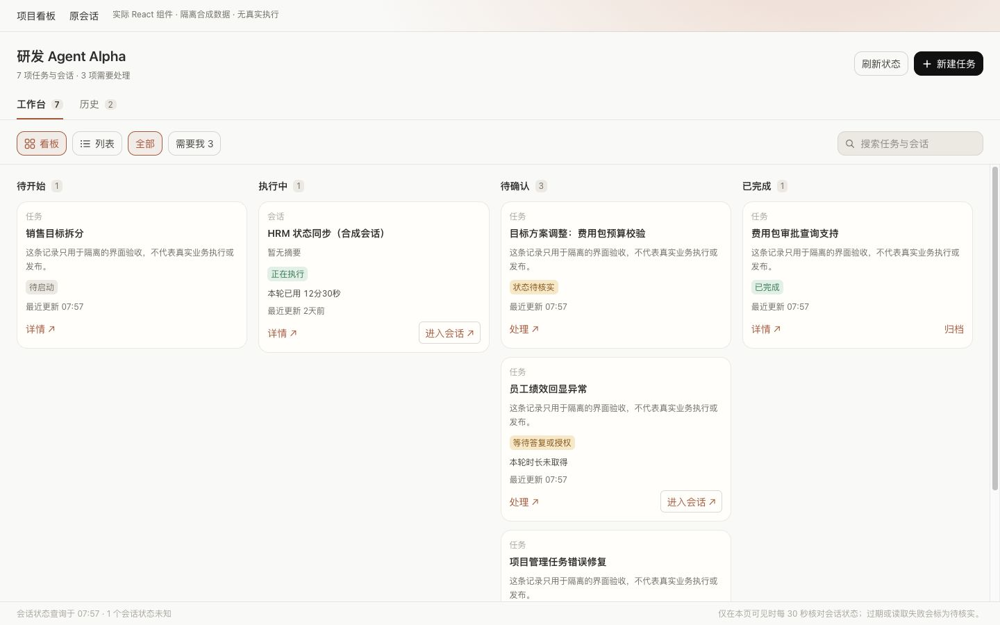

# MOXBOTS-PROJECT-BOARD-004 独立界面审阅

审阅时间：2026-10-15 07:55–08:00（Asia/Shanghai）。基础源码为 `c7bab28594a03dfba7167200a90ae73ad0a6b5aa`，审阅对象为本分支当时的未提交改动。最终提交与远端交付由主 Agent 记录。

审阅者未编写本次 renderer、Task 恢复或 fixture 实现，负责只读代码审阅及实际 React 隔离页面操作；同一审阅者参与了 Session observation 后端修复，所以这份记录不声称后端经过非作者审查。可见工具未确认审阅者实际运行 model/effort 或 token/费用，不估算。

## 结论

四列、历史归档/恢复、详情确认、执行时重跑限制、原会话导航事件及返回状态、540 窄屏焦点行为、独立辅助区展开和深浅主题通过本次隔离组件检查。当前没有以截图或构建成功替代原生/生产验收。

浏览器仅使用后台 Codex IAB，访问 `http://127.0.0.1:8879/__board_state` 与其 `?dark=1` 主题 fixture。没有操作日常 MoXBots App、真实会话或生产数据，没有发起模型执行。截图中的 HRM、任务、交付与导航均为合成数据。

## 实际操作与截图

| 步骤 | 实际检查与结果 | 截图 |
|---|---|---|
| 1 | 1280 桌面四列顺序为待开始、执行中、待确认、已完成；完成 Task 归档后进入历史，工作台计数减少 | [历史初验](screenshots/independent/01-history.jpg) |
| 2 | 同一 Task 恢复后回到已完成列，没有触发重跑 | [恢复后看板](screenshots/independent/02-restored-board.jpg) |
| 3 | 等待答复/授权详情提供原会话入口，没有重新执行或确认完成按钮 | [等待详情](screenshots/independent/03-waiting-detail.jpg) |
| 4 | 成果待确认先进入交付与验收，出现确认说明、实际 TaskDocBlock 和确认完成按钮；随后合成确认使记录转为 done | [确认前检查](screenshots/independent/04-inspect-result.jpg) |
| 5 | 合成 done 任务可重新执行，mock 回传 running executionState 后按钮移除；这不证明真实 Runtime 执行 | [合成重跑](screenshots/independent/05-rerun-synthetic.jpg) |
| 6 | 540×900 详情覆盖内容区，文字和原会话按钮可用；Shift+Tab 从关闭按钮回到末尾，Tab 返回关闭按钮 | [窄屏覆盖层](screenshots/independent/06-narrow-overlay.jpg) |
| 7 | Escape 关闭详情并把焦点还给原 HRM 卡片 | [窄屏返回](screenshots/independent/07-narrow-return.jpg) |
| 8 | 恢复合成 Session 后归入待继续会话；待继续会话和自动任务可同时展开，互不带动；自动任务说明不声称正在执行 | [独立辅助区](screenshots/independent/08-independent-auxiliary.jpg) |
| 9 | 1440×900 浅色四列和状态说明可读，无横向页面溢出 | [1440 浅色](screenshots/independent/09-desktop-1440.jpg) |
| 10 | 1024×900 浅色四列保持顺序，长标题折行 | [1024 浅色](screenshots/independent/10-desktop-1024.jpg) |
| 11 | 在搜索 HRM 并打开详情后，点击详情原会话按钮，实际组件发出既有导航事件并进入 fixture 导航目标 | [模拟会话目标](screenshots/independent/11-chat-navigation-fixture.jpg) |
| 12 | 返回看板，HRM 搜索值、原卡片选择和详情保留；目的地是模拟 Chat，未证明原生真实 Chat 恢复 | [返回保留状态](screenshots/independent/12-return-keeps-selection.jpg) |
| 13 | 历史页头误用工作台待确认计数的问题修复后，实测显示“2 条已归档记录” | [历史计数复核](screenshots/independent/13-history-header-fixed.jpg) |
| 14 | 1440×900 深色布局可读，状态和操作未丢失 | [1440 深色](screenshots/independent/14-dark-1440.jpg) |
| 15 | 540×900 深色列表显示任务、状态与操作，摘要/时间列按现有适配隐藏 | [540 深色列表](screenshots/independent/15-dark-540-list.jpg) |
| 16 | 1024×900 深色四列可读 | [1024 深色](screenshots/independent/16-dark-1024.jpg) |
| 17 | 540×900 浅色分组列表保持四阶段顺序，无整页横向溢出 | [540 浅色](screenshots/independent/17-light-540.jpg) |

关键截图：

## 代码审阅与回归

- 已发现并复核修复：30 秒 tick 取消慢速 50 会话整轮导致饥饿/重叠；归档记录最后已知活跃但读失败/过期时隐藏；归档漏查未出现在 metadata 列表中的 Task.sessionIds；waiting/unknown/stop_failed 时错误展示 rerun；organizing 与其他动作并发；人工 executor=`user` 的 running 进度；历史页头混用工作台待确认数。
- 原三项修复采用单一观察 Promise 串行排空旧 generation、保留最后活跃证据并投影为待核实、按完整 Task.sessionIds 重新读取。没有新增 Session owner 或启动 Session。
- 失败码链路已只读核对：local observation → internal route → Rust business error → management observation → admin route → renderer activity error.code → hook.errorCode → needs/blocked。最后复核发现 Task.executionState=running 可能先于已知 execution_failed，已交主 Agent 修正优先级；该项关闭情况需随后补记。
- 本审阅者使用 Node 24 实跑 backend observation/engine/owner 162 项通过；最后独立实跑 projection/activity/hook/Page 28 项通过，其中 50 个慢请求、隐藏/返回、迟到结果和缺失 metadata 的归档拒绝回归均通过。
- 本审阅者最初的 Rust 测试尝试在 apple-cf Swift manifest 链接阶段失败，未进入测试；不能记作通过。主 Agent 后续 Rust 测试的实际结果以其记录为准。

## 证据边界

- 归档前重新读取不是跨 Rust/Node 的原子锁。归档是可逆整理动作，不能宣称读取之后不会接纳新 turn；活动与状态待核实优先露出用于避免隐藏。
- 默认工作区快照上限 50、并发 4；未观察记录与过期/失败状态有明确说明。截图不能证明真实 owner、持久化、权限、模型或生产结果。
- 浏览器中确认/归档/恢复/重跑只修改 fixture 内存，真实 TaskStore 恢复持久化、Tauri 导航和已安装客户端仍须分别验收。
- 未开展完整 WCAG 对比度量测或读屏器测试。仅验证了可见布局、控件与上述键盘路径。
- 真实运行问题另有只读日志证据：正确日志根为 `~/.moxbot`。同一 HRM 会话本日确有父 turn idle 而后台 child 尚未终态的区间；没有把此直接等同于用户报告时刻的看板响应。安装版只读 CLI 当前 owner 查询返回 `EXTERNAL_CLI_TOKEN_REQUIRED`，未取得当前实际 state；没有读取或回显 token/config。
