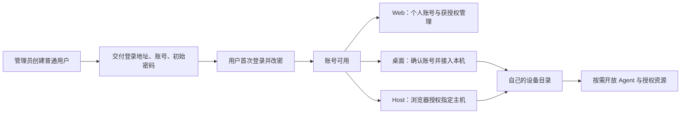

# MOXBOTS-ACCOUNT-FLOW-001：统一账号与各端接入流程

状态：流程设计与实施契约；不是已上线功能。2026-10-16 用户确认采用“管理员直接创建账号并分配初始密码”，保留旧账号设备身份，新客户端等任务空闲后启用。当前生产用户管理只有已注册账号清单，真实新账号登录已完成，但设备连接因身份冲突仍未 ready。

## 1. 用户应理解的一条主线

管理员开户并交付初始密码 → 用户首次登录并设置自己的密码 → 在各端登录同一账号 → 将桌面或 Host 接入自己的网络 → 按需开放 Agent、授权 Bot 和模型。

Web 是账号与管理入口；桌面是日常工作与个人网络入口；Linux Host 是独立执行设备。三端使用同一身份源和稳定用户 ID，各端分别持有会话。用户不需要理解 UUID、PKCE、密钥代次或凭据槽才能完成正常接入。

初始密码交付由管理员自行完成。产品提供一次性显示/复制，不自动发送邮件或消息，不开放公众注册。忘记密码先走管理员重置；未来邮件找回不在本阶段默认范围。

## 2. 当前断点与证据边界

| 断点 | 当前事实 | 对流程的影响 | 源码入口 |
| --- | --- | --- | --- |
| 用户管理未闭环 | 后台仅返回 principal/network 清单，没有用户创建、停用、重置 API | 管理员无法在产品内完成开户 | [admin router/bootstrap](../src/admin_http.rs)、[用户清单](../admin-web/app.js) |
| 身份不可辨认 | AuthStore 按 issuer+subject 建 principal；管理角色来自配置 allowlist，页面主要显示 UUID | 用户难以判断“登录的是谁、拥有什么权限” | [AuthStore](../src/store.rs)、[AdminConfig](../src/admin_store.rs) |
| 账号入口依赖所看网络 | 桌面个人菜单从 selected connection 或第一个 eligible connection 取账号 | 浏览切换容易被理解成切账号 | [OwnedAccountEntry](../../../src/renderer/features/account/OwnedAccountEntry.tsx) |
| 登录与联网混合 | 保存登录连接后才执行设备签发和 Actor 接入 | 登录成功但身份冲突时仍像在无限重连 | [registry](../../../src-tauri/src/agent_network/registry.rs)、[admission](../../../src-tauri/src/agent_network/owned_admission.rs) |
| 设备身份跨账号复用 | 桌面 admission 等仍使用安装级 global deviceId；服务拒绝跨 principal 认领同一 network/device | 新账号不能直接继承旧账号设备 | [account](../../../src-tauri/src/agent_network/account.rs)、[identity](../../../src-tauri/src/agent_network/identity.rs)、[device-core](../device-core/src/lib.rs) |
| 端间操作语义不同 | 桌面退出移除连接；Web 仅注销当前页面会话；Host cancel/logout 共用清理 | 用户无法预测退出、取消、离网会影响哪些对象 | [registry](../../../src-tauri/src/agent_network/registry.rs)、[Web](../admin-web/app.js)、[Host owned](../../../src-tauri/headless-network/src/owned.rs)、[Host state](../../../src-tauri/headless-network/src/owned_state.rs) |
| 页面导航未确认账号 | 桌面打开 Web 仅导航 URL，Web 独立登录 | 浏览器可能使用另一账号 | [ownedCloud](../../../src/renderer/utils/ownedCloud.ts)、[Web](../admin-web/app.js) |

当前 Web/桌面入口已经只读检查；Linux Host 与完整新用户闭环尚未进行真实验收。静态代码、截图和 HTTP 200 分别只证明对应层状态。

## 3. 五类状态各有 owner

| 概念 | 回答的问题 | 权威与边界 |
| --- | --- | --- |
| 用户账号 | 我是谁，是否允许使用本平台 | Dex 验证凭据；现有 AuthStore 拥有稳定 principal 与应用生命周期。显示名/邮箱不能替代 issuer+subject 身份 |
| 当前端会话 | 这个端现在是否获得授权 | 原登录 owner 和 AuthStore session；Web、桌面、Host 分别发放，不能复制 bearer 实现跨端登录 |
| 设备身份 | 哪个账号把这个端接入哪个网络 | 原本地 identity store 与服务端 device identity；owned 身份按安装实例、服务实例、network、principal 隔离 |
| 网络连接 | 当前设备能否协作 | 原 registry/connector/Actor 和服务端 membership；页面选择仅决定展示 |
| 资源权限 | 哪个主体可管理/调用哪个 Host、Bot、模型 | 原资源 grant、Host 本地策略及模型权限 owner；登录、在线或平台管理员身份都不能替代这些授权 |

不新建一套密码库或第二个管理门户。复用 `/admin`、现有 OIDC 与 AuthStore，扩展原生命周期；官方/legacy Space 的账号不能自动与 owned principal 合并。

## 4. 管理员的完整操作

1. 在现有后台“用户”中创建：登录邮箱、显示名、初始密码。默认普通用户；不得顺带赋予 Host、模型、Bot 或平台管理员权限。
2. 保存后显示用户卡片：账号、状态“待首次改密”、创建时间、可访问的服务名称。初始密码只在本次成功响应展示，不进入列表、审计、日志、URL 或普通持久文件。关闭后不能查回；遗失则重置。
3. 管理员按自己的渠道交付固定 HTTPS 登录地址、账号及初始密码。产品不自动对外发送。
4. 用户首次改密成功后，卡片转“正常”；失败保留明确错误与可恢复操作，不显示“已激活”。
5. 管理员可停用、恢复、重置初始密码。停用不删除 principal、设备、Bot 归属、历史或审计。重置保留稳定用户 ID，使原应用会话失效，并再次要求改密。
6. 平台管理员名单本期继续由原受控配置维护；页面显示有效角色。动态角色写管理另立受控变更，不把“创建用户”解释成授权扩大。

用户创建/停用/重置采用独立的受控账号生命周期管理权限及目标用户范围，默认关闭；不能让现有 Bot 管理员自动获得其他用户的密码重置权。平台管理员/恢复账号另有保护，普通账号管理员不能重置受保护管理员、扩大自己的范围或停用最后的恢复入口。实际启用名单由部署 owner 在明确授权下配置。普通用户本人改密使用本人受限授权，不经过要求平台管理员的门禁。

列表至少展示显示名、登录账号、状态、有效角色、最近成功登录；敏感项只对有权管理员可见。设备/会话详情另页按用户查看，不从“账号列表”推断设备在线。

创建与改密涉及 Dex 和 AuthStore 两个既有持久化系统，不能假装成一个数据库事务。使用原审计/操作编号模式记录 `pending → ready / reconciliation_required`；结果未知时按原编号查询，不再次生成用户或重置密码。尚未 ready 的账户不获得普通应用权限。恢复与对账必须核对稳定 Dex userID/connector/issuer-subject 映射，不能按邮箱猜测或接管既有 principal。密码散列仅由 Dex 持久化，AuthStore 保存主体映射、状态和单调递增的 credential revision；进入改密/重置时先 fence 旧代次授权，Dex 更新确认后才提交新状态。所有 session 签发、受限改密授权和待完成登录 continuation 均检查该代次。Dex 已更新而 AuthStore 提交未知时保持待对账，不恢复旧 token 或再发起一次重置。

## 5. 用户首次登录与密码流程

1. 从 Web、桌面或 Host 授权入口发起登录，显示固定服务名称/地址。
2. 在身份页输入管理员提供的账号与初始密码。身份验证后进入同源“设置个人密码”；在改密完成前，不发普通设备/资源会话，不进入网络。
3. 改密表单只允许当前已验证主体，带短期、单次、受限授权及请求防护；不能提交任意目标用户 ID。新密码由用户本人输入，服务只保留符合现有策略的散列，不在客户端保存或记录。
4. 改密完成后销毁受限授权和旧应用会话，再继续原有受约束登录事务；若原事务过期，明确“密码已更新，请重新登录”，不让用户重复改密。
5. 已正常使用的用户可主动改密；必须重新验证当前身份，更新成功后明确其他端重新登录的影响。管理员重置也不能改变 Dex userID 或应用 principal。

首次及重置后的设置密码必须取得当前凭据代次的新鲜验证；旧浏览器 SSO、旧受限授权和重置前的待完成登录均不能代替。该要求由服务端验证与代次校验强制执行，具体 IdP 接线须先做隔离验证，不能仅依赖页面跳转、隐藏按钮或前端的“已验证”状态。

本期设计采用“首次必须改密”。这属于待实现能力，现有 Dex 登录模板/应用接口尚不支持完整链路；不能只加前端跳转后宣称强制生效。旧账号迁移不自动标记强制改密或撤销会话，不影响正在运行的任务。

## 6. 各端接入与交接

| 端 | 正常主路径 | 成功界面 | 必须保留的恢复路径 |
| --- | --- | --- | --- |
| Web 普通用户 | 登录 → 完成首次改密 → 个人账号页 → 按权限进入反馈/社区等 | 显示账号、服务、角色；无管理权限有解释与返回入口 | 过期重新登录、管理员重置说明、当前页退出 |
| Web 管理员 | 同一登录 → 已获授权的 `/admin` | 用户/Host/Bot/模型及审计；菜单显示当前实际账号 | 403 与登录过期分别显示，不循环跳登录 |
| 桌面 | 个人菜单登录 → 回传/检查登录结果 → 确认账号 → 接入本机 → 设备目录 | 分别显示“账号已登录”“本机已连接”；网络条目带账号可读标识 | 取消保留旧登录；同账号重登复用身份；换账号保留旧绑定 |
| Linux Host | 管理员/所有者启动接入 → 输出限时授权链接 → 在浏览器确认账号及目标主机 → 本机确认提交 → 联网 | Host 名称、所属账号、连接状态分别回显；后台收到新鲜观察后才标在线 | cancel 仅撤销本次待登录；logout 独立；固定 pin 迁移显式校验 |

桌面个人菜单的账号选择由原 registry 持有明确引用；`selectedConnectionId` 继续只表示 Bots 网络页在查看哪条连接。不会因为查看另一个网络而静默更换个人菜单账号或停止其他连接。引用失效时显示需要选择，不擅自取另一个账号。

桌面跳 Web 只带非秘密的目的页面与服务上下文，不带 bearer/密码。Web 显示实际账号；不一致时由用户选择继续当前账号或重新登录，不自动登出另一账号。浏览器 SSO 能否减少输入以当前 IdP 实际行为为准；同一身份源不保证同一会话。

Host 每次授权必须确认固定 issuer、Host 名称和目标 scope。登录不会授予平台整机控制，普通在线也不等于可部署 Bot。Host root-managed pin 属于原部署 owner，不能由新账号覆盖。

现有登录 start 仅绑定 deviceId，尚不足以证明浏览器确认的目标 Host。目标确认页与绑定机制属于待实现：Host 名称、固定 pin、issuer、deviceId 及本次操作 ID 必须绑定同一服务端事务；浏览器确认和 Host 本机提交核验同一目标，任一变化取消，不把只显示一段文字当作可验证授权。

## 7. 状态文案与下一步

账号状态和连接状态分别展示；连接只在有效登录、有效设备身份、握手与目录同步满足后标 ready。

| 实际状态 | 用户看到什么 | 主操作 | 系统行为 |
| --- | --- | --- | --- |
| 无账号会话 | 未登录 | 登录 | 本地任务可继续 |
| 初始密码有效但未完成改密 | 请设置个人密码 | 设置密码 | 仅受限改密授权，无普通资源会话 |
| 登录成功，设备尚未接入 | 已登录；本机尚未连接 | 接入本机 | 明确展示接入阶段，不显示已就绪 |
| 设备身份/代次冲突 | 此账号的设备身份需要处理 | 查看处理方式/重新登录原账号 | 停止无意义重试，不换 ID 绕过撤销 |
| 临时网络断开 | 网络中断，正在重试 | 重试/查看详情 | 原连接退避恢复，不退出账号 |
| 登录失效 | 登录已失效，请重新登录 | 重新登录 | 停止认证失败循环；旧身份保留 |
| 账号停用 | 账号已停用，请联系管理员 | 查看账号信息 | 拒绝新授权与权限操作，不显示普通重连 |
| 有效登录但无管理权限 | 此账号无管理权限 | 返回个人页/切换账号 | 不清除有效登录，不循环认证 |
| 目录确认为空 | 已连接，暂无其他设备 | 添加 Host/查看接入步骤 | 与断网、未知或未同步区别显示 |

## 8. 操作影响必须一致

| 操作 | 影响范围 | 保留内容 |
| --- | --- | --- |
| 取消本次登录 | 本次 pending/临时授权 | 原账号会话、连接、设备密钥及任务 |
| 查看另一网络 | 页面展示 | 全部账号会话、正在连接的 Actor、任务 |
| 退出当前端的指定账号 | 该端该账号会话及关联网络准入 | 其他端、其他账号、历史、设备绑定与本地执行 |
| 暂时断开网络连接 | 对应 transport 与当下可调用性 | membership、开放设置、登录、身份及本地执行 |
| 显式离开网络 | 对应 membership 与原 owner 裁决的开放配置清理 | 账号登录、身份密钥、本地执行 |
| 移除本地连接配置 | 明确指定连接的本地配置及会话 | 服务端设备历史；不冒充设备撤销 |
| 撤销指定设备 | 指定身份代次与相应网络/资源准入 | 其他设备、账号与审计；重新接入走显式恢复 |
| 停用用户 | 该主体新登录、签发与已有 live 权限检查 | principal、资产归属、业务数据与审计 |
| 重置密码 | 目标用户凭据及应用会话失效、再次改密 | stable principal、设备身份与资产归属 |

云权限失效不触发本地 SessionEngine stop。远端请求、审批、Host lease 或模型请求若依赖被撤销权限，则由原执行 owner 拒绝后续未授权操作并保留结果状态；不能承诺这些请求继续成功，也不能调用全局 stop 来模拟撤销。

## 9. 兼容迁移与本次连接恢复

1. 保留全部旧连接、原设备 ID、身份密钥、principal 与凭据槽。新的 owned account/device 关系由原 store 持久化，不修改安装级 global deviceId，也不放宽服务端 network/device 唯一约束。
2. `OwnedAccount` 保留登录响应实际绑定的 deviceId；identity admission、discovery、本机判断、Host 向导使用同一个连接身份。官方/legacy 路径维持现有身份语义。
3. 既有登录协议在 start 时绑定 deviceId。兼容路线可先用尚未登记的临时 ID 识别主体；若该主体已有登记身份，精确注销临时会话，再对旧 ID 完成第二轮授权。必须是同一 principal，界面解释“确认恢复这台设备”；不能直接改写 token 的 deviceId。这仅为旧协议兼容方案，不把重复登录作为最终常规体验。目标为一次账号验证后由同一受控事务解析/确认设备绑定；若要修改服务端签发协议，先补充凭据 scope、设备 possession、防重放、取消和旧客户端兼容合同，再实施，不能放宽现有校验换取少点一次。
4. 新账号只在候选查询完整成功、该账号确无既有登记后采用新 ID。保存过连接配置不等于成功登记。查询拒绝、超时、缺密钥或结果不确定不能当作无身份；多候选歧义交由用户明确选择。
5. 登录结果先暂存，在 registry 的最终受控提交中复核 attempt、child epoch、账号、trust、连接存续与取消状态，再安装会话/连接。取消与提交有单一裁决点；晚到结果和清理不能覆盖或删除旧会话。实现使用原凭据路由下按 binding 隔离的不可变会话槽，配置 `sessionBound` 决定新旧槽；写入新槽后原子切换配置，再与 stop 在同一发布锁内授权。回滚结果未知时保留新旧槽和 token、阻止继续登录，任务空闲后重启对账。旧客户端回退必须恢复启用前配置备份，不能删旧凭据或回退业务数据。
6. Host 的固定 pin 迁移单独验证；新登录失败/取消保留旧账号。不能直接套桌面改 ID 策略。
7. 当前新账号连接仍处身份冲突，未恢复 ready。本方案先解决其模型前提；新版本须等运行任务空闲再启用。上线前不得通过编辑真实配置、删旧绑定、改数据库或重启任务绕过。

## 10. 服务接线方案与实施顺序

现有 bootstrap 使用 Dex v2.46.0 staticPasswords。新增用户写管理建议通过服务端私有 Dex adapter：由现有管理/账号 HTTP owner 做鉴权和操作审计，再调用 Dex 密码管理 API；应用账户状态/受限改密授权仍归 AuthStore。前端不能直连 Dex gRPC。Dex API 自身仅提供 TLS 客户端认证，访问控制必须由调用方实现，参见 [官方 API 文档](https://dexidp.io/docs/configuration/api/) 与 [固定 v2.46.0 schema](https://github.com/dexidp/dex/blob/v2.46.0/api/v2/api.proto)。这是待验证接线方案，尚未配置生产 gRPC、迁移 staticPasswords 或增加密码处理接口。

如实施 adapter，管理通道只在既有私有网络中启用并使用双向 TLS，不增加公网端口。[Dex v2.46.0 的 staticPasswords 包装层](https://github.com/dexidp/dex/blob/v2.46.0/storage/static.go)明确优先返回静态账号，并拒绝对静态账号执行 Create/Delete/UpdatePassword；因此旧静态账号迁移前不能宣称支持在线改密。必须先在隔离环境验证动态记录准备与静态配置移除的受控迁移，保留原 userID、密码散列、connector、issuer-subject 映射及恢复路径，备份后再逐账号迁移，禁止重跑 bootstrap。验证重启后不会回退到旧密码；用户已成功改密后不能通过恢复旧静态配置回滚凭据。不能把 Dex userID 直接当应用 principal。

| 阶段 | 交付 | 通过条件 |
| --- | --- | --- |
| A 已独立交付源码 | 认证失效/身份冲突文案与直接重登入口，PR78 | CI 与前端真实渲染交互；不等于日常客户端已更新 |
| B 流程与契约 | 本文、实际界面断点评审、账号开通决策、统一验收表 | 现状和目标分开、每个状态有动作与 owner、取消/退出影响明确 |
| C 优先恢复接入 | 桌面身份隔离、暂存登录、显式账号选择、连接阶段投影；Host 兼容设计 | A/B 两账号同机与同账号重登、取消、故障注入通过；旧身份和任务保留 |
| D 用户生命周期 | 同后台开户/停用/恢复/重置、首次改密、私有 IdP adapter、可读账号与角色 | 全授权路径生效，跨系统未知结果可对账，旧用户迁移通过 |
| E 各端闭环验收与发布 | Web/桌面/Host 与资源授权一致 | 受控真实账号和设备端到端通过；客户端依统一发布 owner，在任务空闲后安装 |

不能用进度百分比合并这些阶段。C/D 可分别交付源码，但缺任一阶段时不宣称“统一账号流程已上线”。后续开发在当前契约下推进，新的 owner、通信方式或权限扩大先明确架构及授权范围。

## 11. 验收用例

| 用例 | 必须观察的真实结果 | 当前状态 |
| --- | --- | --- |
| 管理员创建 A/B | 同后台可追踪开户，默认普通权限，密码只展示一次 | 待实现 |
| 初始密码与首次改密 | 改密前拿不到普通会话；完成后沿原登录返回；旧初始密码不可再用 | 待实现 |
| A 多端登录 | 同 principal、不同 session、各端独立设备身份；Web 显示实际账号 | 部分源码与只读入口检查，完整联调未验 |
| A 同端重登 | device/key 保持；取消、超时、late poll 不破坏旧会话 | 待实施兼容改造与验证 |
| 同机 A 切 B | B 独立设备，A 全部绑定保留；目录不跨账号 | 当前复现冲突，待修复 |
| Host 再登录/取消 | 取消不注销已有账号；pin 不被静默改写 | 待实施/真实验收 |
| 过期/断网/无管理权 | 三种状态文案、动作和后台行为分别正确 | PR78 本地模拟及渲染已验；新客户端原生未验 |
| 当前端退出 | 仅指定 scope 退出；另一端仍可验证；设备历史/本地任务保留 | 待统一验证 |
| 停用/重置/恢复 | 原应用会话与 livehandle 不再授权；恢复仍同 principal，不恢复旧 token | 待实现 |
| 资源权限 | 普通登录、平台管理员或设备在线不额外获得 Host/模型/Bot 权限 | 完整回归待验 |
| 不中断任务 | 原执行 owner、任务状态和进程连续；仅任务空闲后启用新客户端 | 当前未 stop/restart；发布阶段仍待验 |

